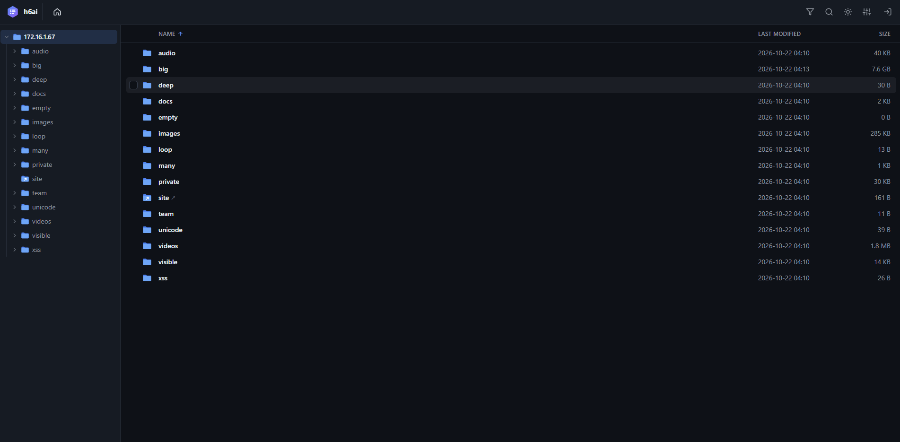
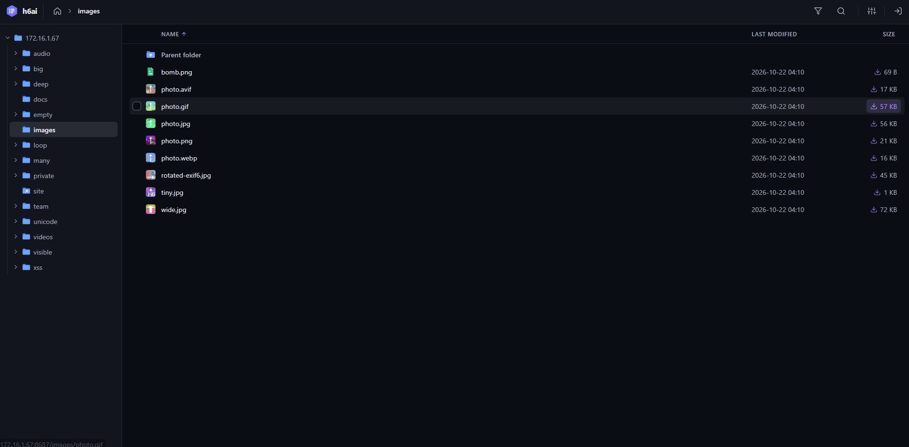
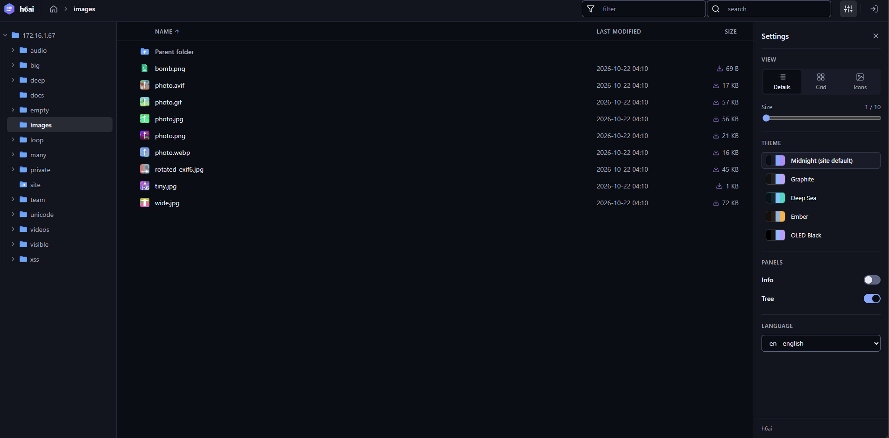
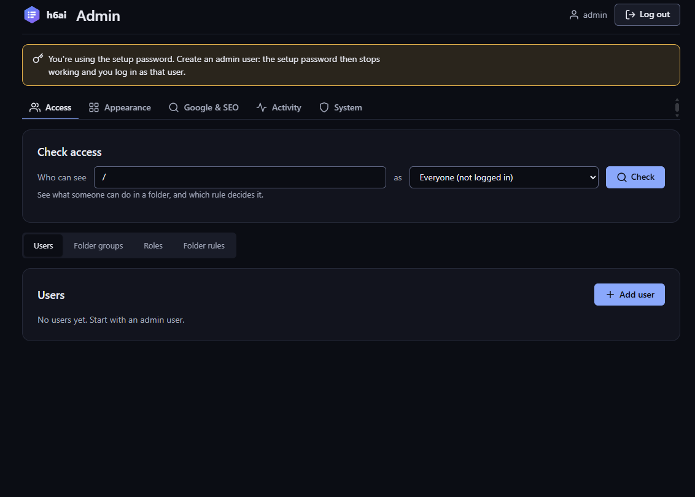
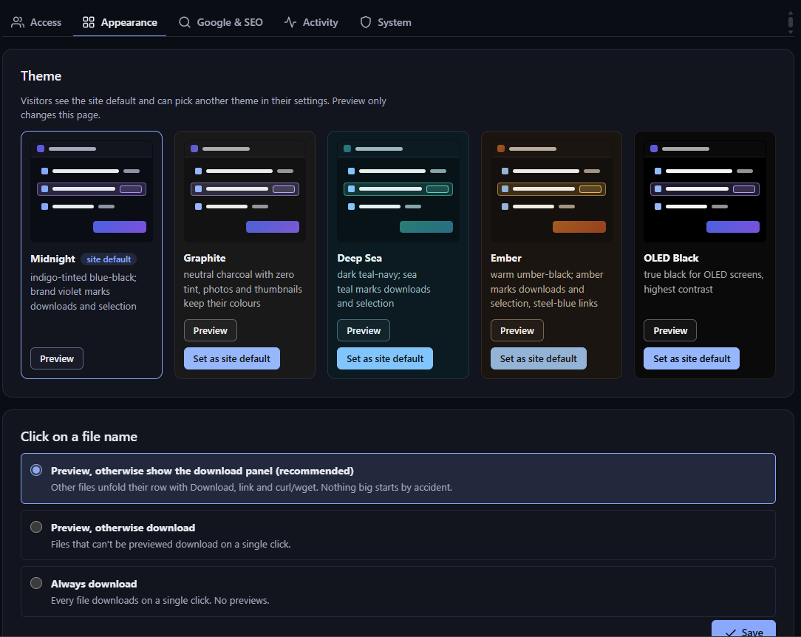
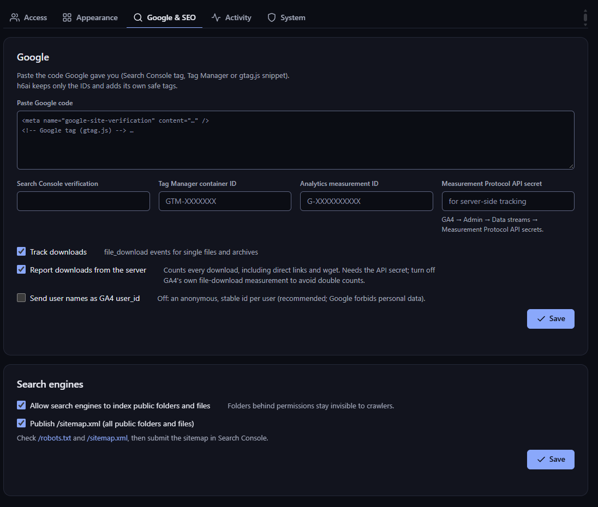
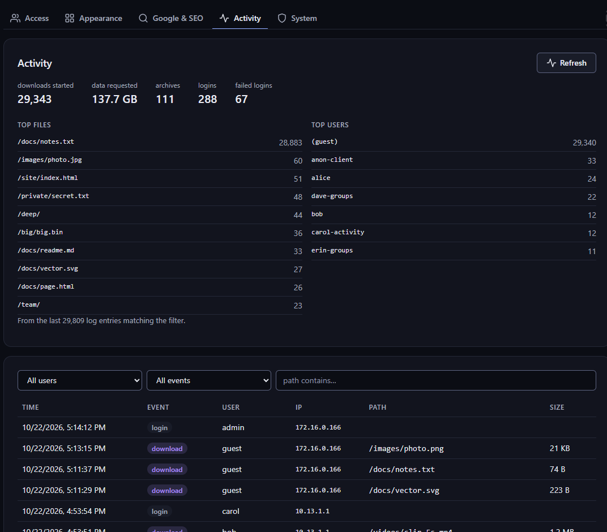

<p align="center">
  <picture>
    <source media="(prefers-color-scheme: dark)" srcset="src/_h6ai/public/images/brand/logo-dark.svg">
    
  </picture>
</p>

<p align="center">
  A fast, secure file index for <b>nginx + PHP-FPM</b>.<br>
  Drop it into a web root and every folder becomes a browsable, searchable download archive.
</p>

<p align="center">
  <a href="https://paulmataruso.github.io/h6ai/">Project page</a> ·
  <a href="https://github.com/paulmataruso/h6ai/releases">Download</a> ·
  <a href="#install">Install</a> ·
  <a href="docs/INSTALL.md">Install guides</a> ·
  <a href="#access-control">Access control</a> ·
  <a href="SECURITY.md">Security</a> ·
  <a href="CHANGELOG.md">Changelog</a>
</p>



h6ai is a maintained successor of [h5ai](https://github.com/lrsjng/h5ai) by Lars Jung, whose last
version, 0.30.0, dates from January 2021. It keeps what made h5ai good: a URL is a folder, no app to learn,
no account needed for public files. It rebuilds the rest for today: security, large files, access
control and a new interface.

## Why h6ai

* **The download is the hero.** Every file shows its size on a download chip. Click a file that
  can't be previewed and its row unfolds in place, without a modal or a new page:
  * a **Download** button that shows the file's size;
  * the direct link;
  * ready-to-paste resumable `curl -C -` and `wget -c` commands;
  * a QR code for phones.

  A stamped confirmation tells you what started. Images, video, audio, text, code and markdown
  open in a preview.
* **Huge files, fast.** h6ai never sits in the data path of a big download. nginx serves every
  byte with sendfile, Range/resume and ETags, and only asks h6ai whether the request is allowed
  (`auth_request`, ~15 ms including the permission check; a drop-in hands big files back to
  nginx with `X-Accel-Redirect`). Multi-GB files resume, stream and
  seek. Folders download as streamed tar or zip archives, with no temp files and no size limit.
  Numbers are in [`docs/PERFORMANCE.md`](docs/PERFORMANCE.md).
* **Zero-friction browsing.**
  * Navigation: breadcrumb, folder tree, filter (`/`) and recursive search (`s`).
  * Views and thumbnails: details, grid and gallery views, with image, video and PDF thumbnails.
  * Keyboard: navigable throughout.
  * Phones and old browsers: works on phones and without JavaScript.
* **Access control that covers direct links.**
  * Access levels per folder, for roles, users and folder groups.
  * Download-only "anon" accounts for clients and partners.
  * Enforced by nginx on every file URL, not just in the listing.
* **Five dark themes.** Midnight, Graphite, Deep Sea, Ember and OLED Black. The admin picks the
  site default and visitors can choose their own. Every theme is checked for WCAG AA contrast.
* **Visible to Google.**
  * Paste your Search Console / Tag Manager / GA4 snippet in the admin.
  * h6ai generates `robots.txt` and a `sitemap.xml` of all public content.
  * Downloads can be sent to GA4 server-side, so direct links and `curl` downloads count too.
* **Secure by default.** It fixes the known h5ai vulnerabilities (path traversal, stored XSS,
  weak admin auth, DoS vectors) and adds:
  * a nonce-based Content-Security-Policy, CSRF and origin checks;
  * login rate limiting;
  * hardened sessions;
  * mitigations for CVE-2026-109618 and CVE-2026-10961.

  Details are in [`SECURITY.md`](SECURITY.md) and [`docs/AUDIT.md`](docs/AUDIT.md).

## Screenshots

| | |
|---|---|
|  |  |
| Every file row ends in a download chip with its size. | Settings: views, the five dark themes, panels, language. |
|  |  |
| A file without a preview unfolds into its download band. | Admin, Access: who can see a folder, and which rule decides it. |
|  |  |
| Admin, Appearance: the site's default theme and click behaviour. | Admin, Google & SEO: Search Console, GA4, sitemap. |
|  |  |
| Admin, Activity: downloads, archives and logins. | On a phone. |

## Install

Three ways, with the same features. Each has a step-by-step guide:

| | |
|---|---|
| **[Native](docs/install/native.md)** | directly on the server's OS (bare metal or VM): `sudo ./install.sh --native` sets up nginx and PHP-FPM from the distribution's packages on Debian, Ubuntu, Fedora, RHEL/Rocky/Alma and Alpine |
| **[Docker](docs/install/docker.md)** | one container with its own nginx and PHP-FPM: `sudo ./install.sh --docker`, or `docker compose up -d` in a checkout |
| **[Drop-in](docs/install/dropin.md)** | the h5ai way: unzip `_h6ai` into the web root of the nginx + PHP you already run, add one line, finish in the browser |

```sh
curl -LO https://github.com/paulmataruso/h6ai/releases/download/v1.0.1/h6ai-1.0.1.tar.gz
tar xzf h6ai-1.0.1.tar.gz && cd h6ai-1.0.1
sudo ./install.sh                              # asks: natively on this system, or in Docker
```

The installer checks PHP for the CVE-2026-109618 fix. It runs h6ai in its own PHP-FPM pool and
system user (native) or container (Docker), creates the first admin and prints the URLs. Run it
again to upgrade; `--uninstall` removes it. Every supported distribution is tested with the full
integration suite.

For a drop-in, unzip `h6ai-1.0.1-dropin.zip` into the web root, keep your files in a folder
outside it, and add this to the server block:

```nginx
error_page 403 404 = /_h6ai/public/index.php;
```

Then open `/_h6ai/public/`: it asks for the files folder and a password and gives you a setup file
to upload. No shell is needed. Every request reaches h6ai, so permissions, the download log and
the HTML sandbox work as in the other two, and nginx still sends big files. The admin page checks
the setup from your browser.

Overview and comparison: [`docs/INSTALL.md`](docs/INSTALL.md).

## Access control

Everything is public until you add a rule. Admin → Access → Visitors chooses how visitors use
the site:

* **Public, with sign-in** (default): visitors browse everything that isn't restricted, and
  people with an account sign in from the listing to see the folders shared with them.
* **Anonymous, no sign-in**: no sign-in anywhere in the listing. Everyone browses and downloads
  everything except the **excluded folders** you pick on the same page. Excluded folders vanish
  completely for visitors (listing, search, downloads, sitemap; direct links get 403). Only admins
  sign in, on the admin page.

Levels are ordered:

| Level | Can |
|-------|-----|
| `none` | not see the folder at all |
| `list` | see the folder and its file names |
| `read` | also preview and open files |
| `download` | also download files and packaged archives |

* **Rules** are set on folders and inherited down the tree. Each rule grants a level to everyone
  (`*`), a role or a single user. The most specific grant wins.
* **Roles** group users (`admin`, `user`, or your own).
* **Folder groups** are named lists of folders. Assign a group to a user and pick the level for
  that user.
* **Anon accounts** are download-only and default-deny. They see only the folder groups shared
  with them, ignore public and role grants, get no previews and can't change their password. Use
  them for clients collecting deliverables.
* **The access checker** answers "who can see this folder, and which rule decides it?" before you
  share a link.

Every file request passes h6ai first, so a denied file returns 401 or 403 even when someone has
the direct URL. Native and Docker installs use nginx's `auth_request`; a drop-in serves its files
folder through h6ai. Protected folders never appear in the sitemap.

### Behind a reverse proxy

Admin → System → *Public address and reverse proxy*:

* **Public address**: the address visitors use (`https://files.example.com`). Download links,
  curl/wget lines, QR codes, the sitemap and server-side Analytics use it, and logins that arrive
  through the proxy are accepted for it.
* **Trusted proxies**: IPs or CIDR ranges allowed to set `X-Forwarded-For`, `-Proto` and `-Host`.
  h6ai then logs, rate-limits and reports the visitor's real address. Headers from anyone else
  are ignored.

The card shows how h6ai sees your own request, including which address to trust.

## Configuration

Most settings live in the admin UI:
* users and access, anonymous mode and excluded folders;
* the public address and trusted reverse proxies;
* theme;
* what a click on a file name does;
* site name;
* Google & SEO;
* the activity log.

File-level options are in `_h6ai/private/conf/options.json`. Don't edit that file. Put overrides
into `_h6ai/private/conf/options.local.json`: it is deep-merged over the defaults and survives
upgrades. Every option is documented inline.

| Option | Default | |
|--------|---------|-|
| `security.csp` | `true` | auto-derived Content-Security-Policy, `false`, or a custom policy string |
| `security.loginMaxAttempts` / `loginWindow` | `5` / `900` | login rate limit per client IP |
| `security.sessionMaxAge` | `43200` | seconds |
| `view.maxEntries` | `20000` | most entries listed per folder |
| `download.type` / `maxEntries` | `"php-tar"` / `200000` | archive format and size cap |
| `search.enabled` / `maxResults` / `timeLimit` | `false` / `1000` / `10` | recursive search and its bounds |
| `thumbnails.maxPixels` / `cacheMaxSize` | `40000000` / `1024` | decompression-bomb guard; cache MB |
| `foldersize.cacheTtl` | `600` | seconds a computed folder size is cached |

## Build

Requires Node.js ≥ 20.

```sh
npm ci
npm run build          # -> build/_h6ai
npm run build:dev      # unminified + sourcemaps
npm run watch          # rebuild on change
npm run release        # build/h6ai-<version>.{tar.gz,zip} (installer) and -dropin.{tar.gz,zip}
```

The frontend is vanilla JavaScript and plain CSS bundled by esbuild. The backend is PHP ≥ 8.2
with `strict_types`. There are no runtime dependencies beyond marked, DOMPurify, kjua and lolight.

## Tests

```sh
npm run check              # ESLint + unit tests
npm run test:integration   # 125 HTTP tests against the dev container (security, RBAC, CVEs, large files)
npm run test:e2e           # Playwright in Docker: visitor, admin, anon and mobile flows
npm run test:native        # install.sh on 8 distributions + systemd + Docker mode; a drop-in on stock nginx
```

The integration and browser tests expect the development environment:
`docker compose -f compose.yaml -f compose.dev.yaml up -d --build` (sample tree, bootstrap login
`admin` / `admin-test`, port 8687).

## Project layout

```
src/_h6ai/public/       UI: js/lib (views, extensions, admin), css (tokens, themes, components), images
src/_h6ai/private/      PHP backend, options, translations, data (users, settings, activity log)
install.sh              native installer
deploy/                 nginx and PHP configuration shared by Docker and the native install
docker/                 container entrypoint, nginx main config, seed scripts for the dev environment
docs/                   install, deployment, audit, plan, performance, Rust evaluation
test/ test-integration/ test-e2e/ test-native/
```

## Credits and license

MIT, see [`LICENSE`](LICENSE). h6ai is based on [h5ai](https://github.com/lrsjng/h5ai)
© Lars Jung. It builds on other MIT-licensed projects, except some
[Material Design icons](https://github.com/google/material-design-icons) (CC BY 4.0).
