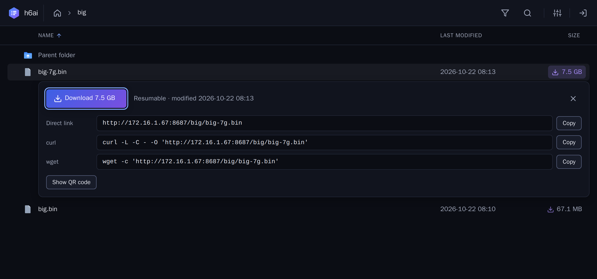
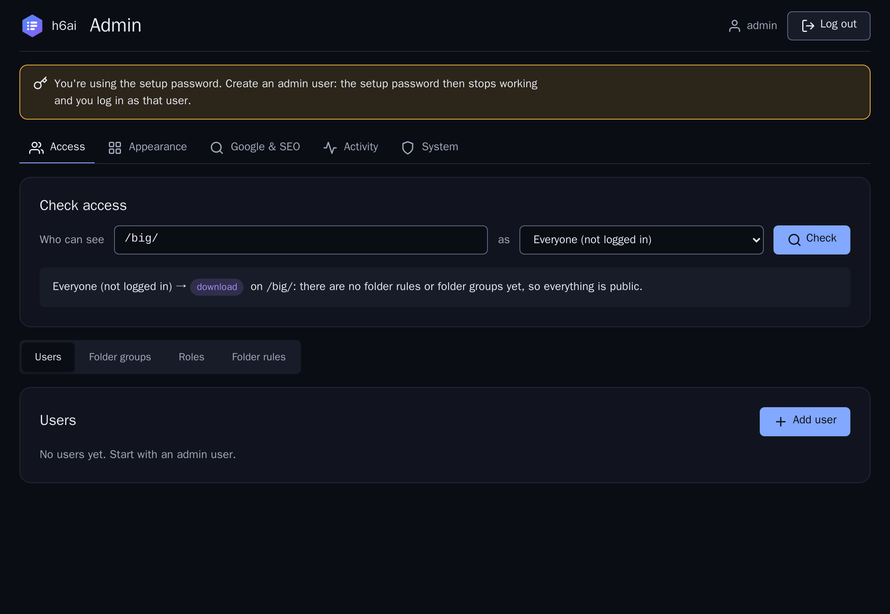
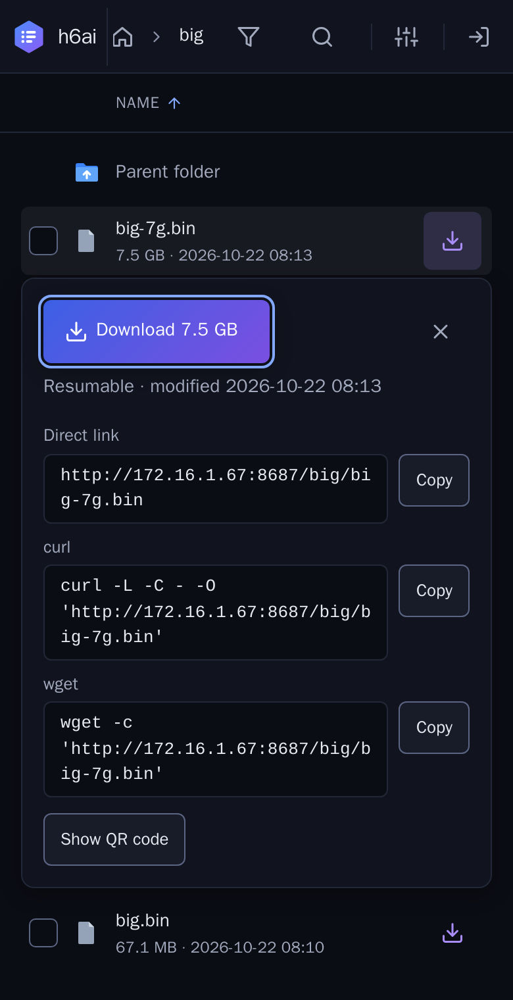
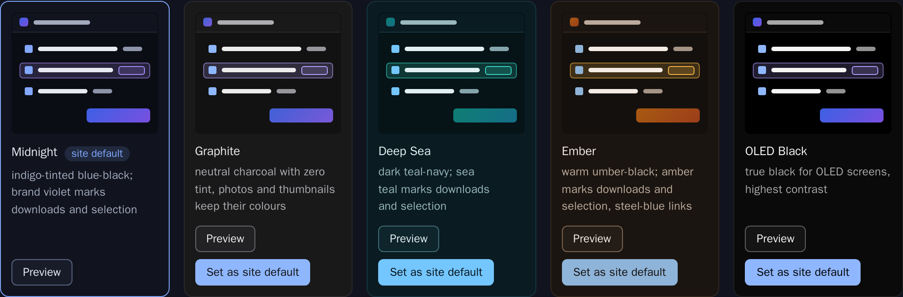

<p align="center">
  <picture>
    <source media="(prefers-color-scheme: dark)" srcset="src/_h6ai/public/images/brand/logo-dark.svg">
    
  </picture>
</p>

<p align="center">
  A fast, secure file index for <b>nginx + PHP-FPM</b>.<br>
  Drop it into a web root and every folder becomes a browsable, searchable download archive.
</p>

<p align="center">
  <a href="#quick-start-docker">Quick start</a> ·
  <a href="docs/DEPLOYMENT.md">Deploy on your nginx</a> ·
  <a href="#access-control">Access control</a> ·
  <a href="SECURITY.md">Security</a> ·
  <a href="CHANGELOG.md">Changelog</a>
</p>



h6ai is a maintained successor of [h5ai](https://github.com/lrsjng/h5ai) by Lars Jung, which has
not been maintained since 2020. It keeps what made h5ai good: a URL is a folder, no app to learn,
no account needed for public files. It rebuilds the rest for today: security, large files, access
control and a new interface.

## Why h6ai

* **The download is the hero.** Every file shows its size on a download chip. Click a file that
  can't be previewed and its row unfolds in place, without a modal or a new page:
  * a **Download 7.5 GB** button;
  * the direct link;
  * ready-to-paste resumable `curl -C -` and `wget -c` commands;
  * a QR code for phones.

  A stamped confirmation tells you what started. Images, video, audio, text, code and markdown
  open in a preview.
* **Huge files, fast.** h6ai never sits in the data path of a file download. nginx serves every
  byte with sendfile, Range/resume and ETags, and only asks h6ai whether the request is allowed
  (`auth_request`, ~15 ms including the permission check). Multi-GB files resume, stream and
  seek. Folders download as streamed tar or zip archives, with no temp files and no size limit.
  Numbers are in [`docs/PERFORMANCE.md`](docs/PERFORMANCE.md).
* **Zero-friction browsing.**
  * Navigation: breadcrumb, folder tree, filter (`/`) and recursive search (`s`).
  * Views and thumbnails: details, grid and gallery views, with image, video and PDF thumbnails.
  * Keyboard: navigable throughout.
  * Phones and old browsers: works on phones and without JavaScript.
* **Access control that covers direct links.**
  * Access levels per folder, for roles, users and folder groups.
  * Download-only "anon" accounts for clients and partners.
  * Enforced by nginx on every file URL, not just in the listing.
* **Five dark themes.** Midnight, Graphite, Deep Sea, Ember and OLED Black. The admin picks the
  site default and visitors can choose their own. Every theme is checked for WCAG AA contrast.
* **Visible to Google.**
  * Paste your Search Console / Tag Manager / GA4 snippet in the admin.
  * h6ai generates `robots.txt` and a `sitemap.xml` of all public content.
  * Downloads can be sent to GA4 server-side, so direct links and `curl` downloads count too.
* **Secure by default.** It fixes the known h5ai vulnerabilities (path traversal, stored XSS,
  weak admin auth, DoS vectors) and adds:
  * a nonce-based Content-Security-Policy, CSRF and origin checks;
  * login rate limiting;
  * hardened sessions;
  * mitigations for CVE-2026-109618 and CVE-2026-10961.

  Details are in [`SECURITY.md`](SECURITY.md) and [`docs/AUDIT.md`](docs/AUDIT.md).

<table>
  <tr>
    <td width="62%"></td>
    <td width="38%"></td>
  </tr>
  <tr>
    <td colspan="2"></td>
  </tr>
</table>

## Quick start (Docker)

```sh
docker compose up --build -d
```

* Files: <http://172.16.1.67:8687/>. Set `H6AI_BIND` / `H6AI_PORT` to change the address.
* Admin: <http://172.16.1.67:8687/_h6ai/public/>.
  * Bootstrap login: user `admin`, password `admin-test`.
  * Create a real admin user right away: the bootstrap password stops working once one exists.
  * Set your own bootstrap hash with `H6AI_PASSHASH`: `php _h6ai/private/bin/h6ai-passhash.php`
    prints one.
* The share is `./webroot` on the host. The image seeds sample folders on first start, including
  a large test file (`H6AI_SEED_BIG_GB`, default 7) in `webroot/big/` for download benchmarks.

The image runs nginx and PHP-FPM 8.3 (patched, version-gated at build time) with OPcache and JIT.
It is tuned for large files. See [`docker/README.md`](docker/README.md).

To run h6ai on your own nginx, copy `build/_h6ai` into the web root, add
`/_h6ai/public/index.php` as the last `index` entry, and include the `auth_request` gate. The
guide is [`docs/DEPLOYMENT.md`](docs/DEPLOYMENT.md).

## Access control

Everything is public until you add a rule. Levels are ordered:

| Level | Can |
|-------|-----|
| `none` | not see the folder at all |
| `list` | see the folder and its file names |
| `read` | also preview and open files |
| `download` | also download files and packaged archives |

* **Rules** are set on folders and inherited down the tree. Each rule grants a level to everyone
  (`*`), a role or a single user. The most specific grant wins.
* **Roles** group users (`admin`, `user`, or your own).
* **Folder groups** are named lists of folders. Assign a group to a user and pick the level for
  that user.
* **Anon accounts** are download-only and default-deny. They see only the folder groups shared
  with them, ignore public and role grants, get no previews and can't change their password. Use
  them for clients collecting deliverables.
* **The access checker** answers "who can see this folder, and which rule decides it?" before you
  share a link.

nginx asks h6ai about every file request (`auth_request`), so a denied file returns 401 or 403
even when someone has the direct URL. Protected folders never appear in the sitemap.

## Configuration

Most settings live in the admin UI:
* users and access;
* theme;
* what a click on a file name does;
* site name;
* Google & SEO;
* the activity log.

File-level options are in `_h6ai/private/conf/options.json`. Don't edit that file. Put overrides
into `_h6ai/private/conf/options.local.json`: it is deep-merged over the defaults and survives
upgrades. Every option is documented inline.

| Option | Default | |
|--------|---------|-|
| `security.csp` | `true` | auto-derived Content-Security-Policy, `false`, or a custom policy string |
| `security.loginMaxAttempts` / `loginWindow` | `5` / `900` | login rate limit per client IP |
| `security.sessionMaxAge` | `43200` | seconds |
| `view.maxEntries` | `20000` | most entries listed per folder |
| `download.type` / `maxEntries` | `"php-tar"` / `200000` | archive format and size cap |
| `search.enabled` / `maxResults` / `timeLimit` | `false` / `1000` / `10` | recursive search and its bounds |
| `thumbnails.maxPixels` / `cacheMaxSize` | `40000000` / `1024` | decompression-bomb guard; cache MB |
| `foldersize.cacheTtl` | `600` | seconds a computed folder size is cached |

## Build

Requires Node.js ≥ 20.

```sh
npm ci
npm run build          # -> build/_h6ai
npm run build:dev      # unminified + sourcemaps
npm run watch          # rebuild on change
npm run release        # build/h6ai-<version>.tar.gz (+ .zip if `zip` is installed)
```

The frontend is vanilla JavaScript and plain CSS bundled by esbuild. The backend is PHP ≥ 8.2
with `strict_types`. There are no runtime dependencies beyond marked, DOMPurify, kjua and lolight.

## Tests

```sh
npm run check              # ESLint + unit tests
npm run test:integration   # 125 HTTP tests against the running container (security, RBAC, CVEs, large files)
npm run test:e2e           # Playwright in Docker: visitor, admin, anon and mobile flows
```

## Project layout

```
src/_h6ai/public/       UI: js/lib (views, extensions, admin), css (tokens, themes, components), images
src/_h6ai/private/      PHP backend, options, translations, data (users, settings, activity log)
docker/                 nginx, PHP-FPM, entrypoint and seed scripts
docs/                   audit, plan, deployment, performance, Rust evaluation
test/ test-integration/ test-e2e/
```

## Credits and license

MIT, see [`LICENSE`](LICENSE). h6ai is based on [h5ai](https://github.com/lrsjng/h5ai)
© Lars Jung. It builds on other MIT-licensed projects, except some
[Material Design icons](https://github.com/google/material-design-icons) (CC BY 4.0).
